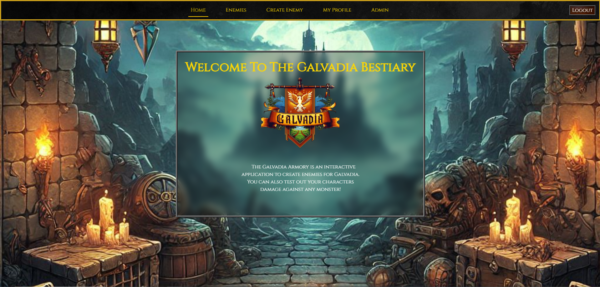
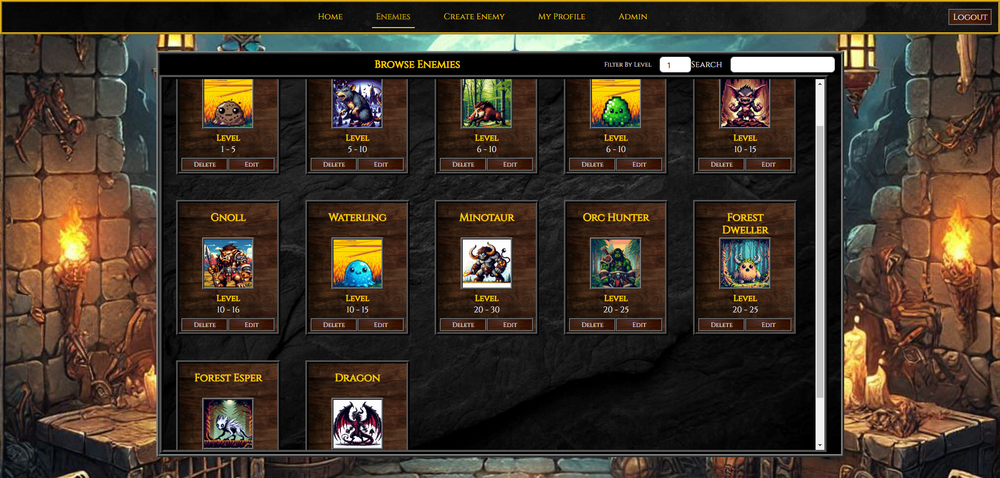
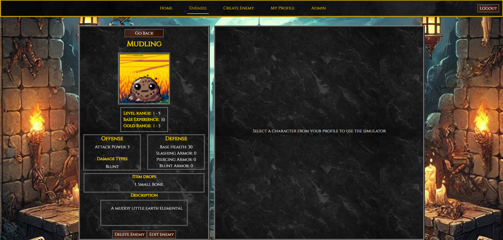
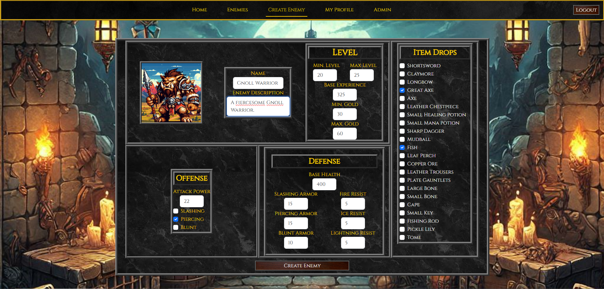
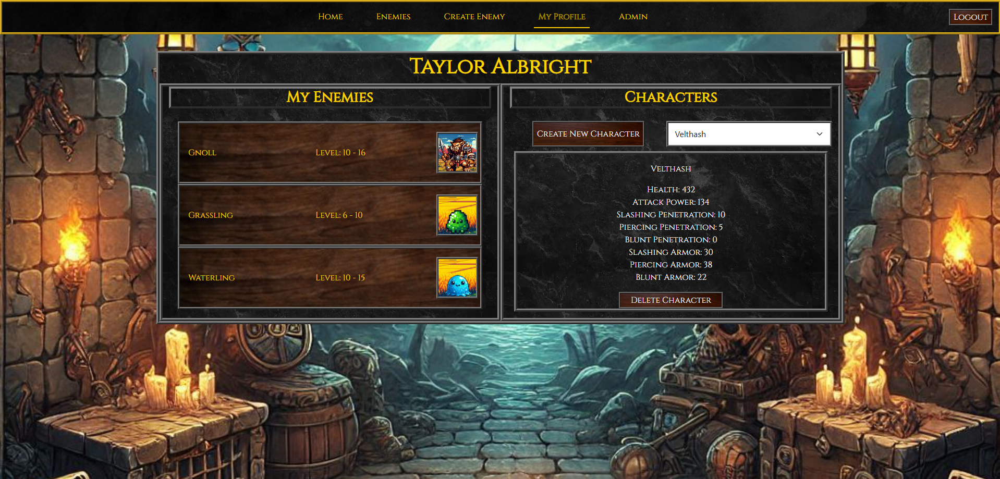
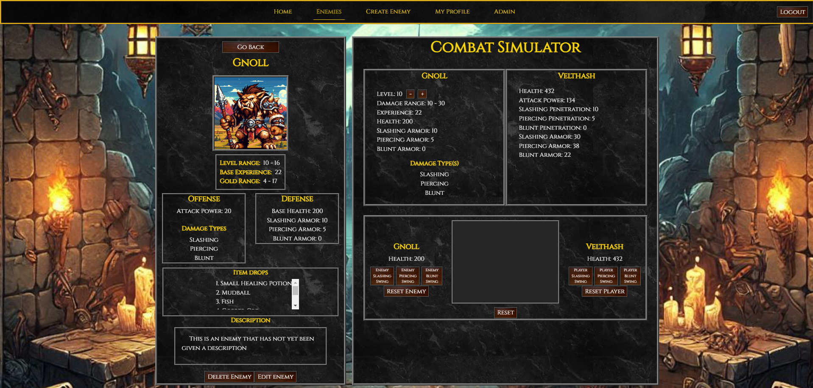

# Capstone: Galvadia Enemy Compendium

   

This is a support application used to create and store representations of enemies for my game, Galvadia. It allows me to create enemies and test their values for in-game scaling. It includes a combat simulator that tests an enemy's damage vs a player as well as a player's damage vs an enemy.

### ** PostgreSQL is needed to run this application! **

## Table of Contents
- [Installation](#installation)
- [Features](#features)
- [Technologies Used](#technologies-used)

## Installation
1. Clone the repository.
2. Cd into the client directory.
3. Run `npm install` to install dependencies.
4. Run `npm run dev`. This will open a window in your browser. It will not be working until you complete the next step.
5. Open a new terminal window and cd into the root folder.
6. Start the development server through your debugger.
7. Refresh your browser with the localhost url (localhost:5173 by default).
8. Good to go!

## Features

1. **Logging in**
   - You can create your own account by registering, however, only the administrator has admin privileges. Once you create your own account, you can log in with the administrator account and promote yourself to admin through the Admin panel (linked at the top in the navbar).
   - To log in as the default administrator, use these credentials:
   - Email: admina@strator.comx
   - Password: password

### Main Views:

1. **Enemies**

   
   
   
   - You can view all created enemies in this view.
   - You can select any enemy by clicking on its portrait.
   - Only administrators can edit or delete an enemy.

     
2. **Enemy Details**

   
   

   - You can view an enemies details here. Once you select a character from the My Profile view, you can interact with the combat simulator.
  
3. **Create Enemy**

   

   - This is where you can create an enemy by assigning it a name, picture, stat values, etc. The armor, level, and damage values can be tested in the combat simulator.
  
4. **My Profile**

   

   - This is where you set up a character to reflect your in-game character for testing. It also lists all the enemies that a user has created in the left panel.

5. **Combat Simulator**

      

   - This is where you can test enemy damage vs a player and a player's damage vs an enemy. All calculations are based on the stats of each player and enemy. Armor and armor penetration are taken into consideration when calculating the damage and amount blocked. The exact formula can be found in the code.
  
## Technologies Used

### Languages
1. JavaScript
2. C#
3. CSS

### Frameworks
1. .NET
2. Entity Framework Core
3. Bootstrap

### Libraries
1. React
2. Reactstrap

### Backend Services
1. Firebase
